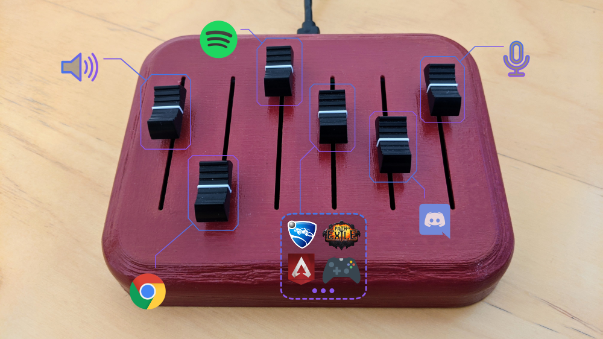
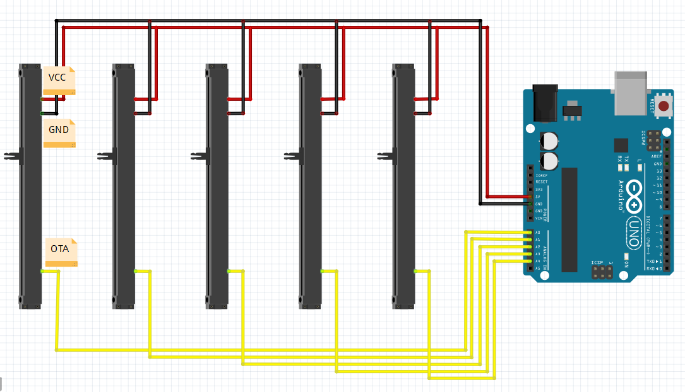

# deej

deej is an **open-source hardware volume mixer** for Windows and Linux PCs. It lets you use real-life sliders (like a DJ!) to **seamlessly control the volumes of different apps** (such as your music player, the game you're playing and your voice chat session) without having to stop what you're doing.

**Join the [deej Discord server](https://discord.gg/nf88NJu) if you need help or have any questions!**

[](https://discord.gg/nf88NJu)

> **_New:_** [work-in-progress deej FAQ](./docs/faq/faq.md)!

deej consists of a [lightweight desktop client](#features) written in Go, and an Arduino-based hardware setup that's simple and cheap to build. [**Check out some versions built by members of our community!**](./community.md)

**[Download the latest release](https://github.com/omriharel/deej/releases/latest) | [Video demonstration](https://youtu.be/VoByJ4USMr8) | [Build video by Tech Always](https://youtu.be/x2yXbFiiAeI)**



> _**Psst!** [No 3D printer? No problem!](./assets/build-shoebox.jpg)_ You can build deej on some cardboard, a shoebox or even a breadboard :)

## Table of contents

- [Features](#features)
- [How it works](#how-it-works)
  - [Hardware](#hardware)
    - [Schematic](#schematic)
  - [Software](#software)
- [Slider mapping (configuration)](#slider-mapping-configuration)
- [Build your own!](#build-your-own)
  - [FAQ](#faq)
  - [Build video](#build-video)
  - [Bill of Materials](#bill-of-materials)
  - [Thingiverse collection](#thingiverse-collection)
  - [Build procedure](#build-procedure)
- [How to run](#how-to-run)
  - [Requirements](#requirements)
  - [Download and installation](#download-and-installation)
  - [Building from source](#building-from-source)
- [Community](#community)
- [License](#license)

## Features

deej is written in Go and [distributed](https://github.com/omriharel/deej/releases/latest) as a portable (no installer needed) executable.

- Bind apps to different sliders
  - Bind multiple apps per slider (i.e. one slider for all your games)
  - Bind the master channel
  - Bind "system sounds" (on Windows)
  - Bind specific audio devices by name (on Windows)
  - Bind currently active app (on Windows)
  - Bind all other unassigned apps
- Control your microphone's input level
- Lightweight desktop client, consuming around 10MB of memory
- Runs from your system tray
- Helpful notifications to let you know if something isn't working

> **Looking for the older Python version?** It's no longer maintained, but you can always find it in the [`legacy-python` branch](https://github.com/omriharel/deej/tree/legacy-python).

## How it works

### Hardware

- The sliders are connected to 5 (or as many as you like) analog pins on an Arduino Nano/Uno board. They're powered from the board's 5V output (see schematic)
- The board connects via a USB cable to the PC

#### Schematic



### Software

- The code running on the Arduino board is a [C program](./arduino/deej-5-sliders-vanilla/deej-5-sliders-vanilla.ino) constantly writing current slider values over its serial interface
- The PC runs a lightweight [Go client](./pkg/deej/cmd/main.go) in the background. This client reads the serial stream and adjusts app volumes according to the given configuration file

## Slider mapping (configuration)

deej uses a simple YAML-formatted configuration file named [`config.yaml`](./config.yaml), placed alongside the deej executable.

The config file determines which applications (and devices) are mapped to which sliders, and which parameters to use for the connection to the Arduino board, as well as other user preferences.

**This file auto-reloads when its contents are changed, so you can change application mappings on-the-fly without restarting deej.**

It looks like this:

```yaml
slider_mapping:
  0: master
  1: chrome.exe
  2: spotify.exe
  3:
    - pathofexile_x64.exe
    - rocketleague.exe
  4: discord.exe

# set this to true if you want the controls inverted (i.e. top is 0%, bottom is 100%)
invert_sliders: false

# settings for connecting to the arduino board
com_port: COM4
baud_rate: 9600

# adjust the amount of signal noise reduction depending on your hardware quality
# supported values are "low" (excellent hardware), "default" (regular hardware) or "high" (bad, noisy hardware)
noise_reduction: default
```

- `master` is a special option to control the master volume of the system _(uses the default playback device)_
- `mic` is a special option to control your microphone's input level _(uses the default recording device)_
- `deej.unmapped` is a special option to control all apps that aren't bound to any slider ("everything else")
- On Windows, `deej.current` is a special option to control whichever app is currently in focus
- On Windows, you can specify a device's full name, i.e. `Speakers (Realtek High Definition Audio)`, to bind that device's level to a slider. This doesn't conflict with the default `master` and `mic` options, and works for both input and output devices.
  - Be sure to use the full device name, as seen in the menu that comes up when left-clicking the speaker icon in the tray menu
- `system` is a special option on Windows to control the "System sounds" volume in the Windows mixer
- All names are case-**in**sensitive, meaning both `chrome.exe` and `CHROME.exe` will work
- You can create groups of process names (using a list) to either:
    - control more than one app with a single slider
    - choose whichever process in the group that's currently running (i.e. to have one slider control any game you're playing)

## Build your own!

Building deej is very simple. You only need a few relatively cheap parts - it's an excellent starter project (and my first Arduino project, personally). Remember that if you need any help or have a question that's not answered here, you can always [join the deej Discord server](https://discord.gg/nf88NJu).

Build deej for yourself, or as an awesome gift for your gaming buddies!

### FAQ

I've started a highly focused effort of writing a proper FAQ page for deej, covering many basic and advanced topics.

It is still _very much a work-in-progress_, but I'm happy to [share it in its current state](./docs/faq/faq.md) in hopes that it at least covers some questions you might have.

FAQ feedback in our [community Discord](https://discord.gg/nf88NJu) is strongly encouraged :)

### Build video

In case you prefer watching to reading, Charles from the [**Tech Always**](https://www.youtube.com/c/TechAlways) YouTube channel has made [**a fantastic video**](https://youtu.be/x2yXbFiiAeI) that covers the basics of building deej for yourself, including parts, costs, assembly and software. I highly recommend checking it out!

### Bill of Materials

- An Arduino Nano, Pro Micro or Uno board
  - I officially recommend using a Nano or a Pro Micro for their smaller form-factor, friendlier USB connectors and more analog pins. Plus they're cheaper
  - You can also use any other development board that has a Serial over USB interface
- A few slider potentiometers, up to your number of free analog pins (the cheaper ones cost around 1-2 USD each, and come with a standard 10K Ohm variable resistor. These _should_ work just fine for this project)
  - **Important:** make sure to get **linear** sliders, not logarithmic ones! Check the product description
  - You can also use circular knobs if you like
- Some wires
- Any kind of box to hold everything together. **You don't need a 3D printer for this project!** It works fantastically with just a piece of cardboard or a shoebox. That being said, if you do have one, read on...

### Thingiverse collection

With many different 3D-printed designs being added to our [community showcase](./community.md), it felt right to gather all of them in a Thingiverse collection for you to browse. If you have access to a 3D printer, feel free to use one of the designs in your build.

**[Visit our community-created design collection on Thingiverse!](https://thingiverse.com/omriharel/collections/deej)**

> You can also [submit your own](https://discord.gg/nf88NJu) design to be added to the collection. Regardless, if you do upload your design to Thingiverse, _please add a `deej` tag to it so that others can find it more easily_.


### Build procedure

- Connect everything according to the [schematic](#schematic)
- Test with a multimeter to be sure your sliders are hooked up correctly
- Flash the Arduino chip with the sketch in [`arduino\deej-5-sliders-vanilla`](./arduino/deej-5-sliders-vanilla/deej-5-sliders-vanilla.ino)
  - _Important:_ If you have more or less than 5 sliders, you must edit the sketch to match what you have
- After flashing, check the serial monitor. You should see a constant stream of values separated by a pipe (`|`) character, e.g. `0|240|1023|0|483`
  - When you move a slider, its corresponding value should move between 0 and 1023
- Congratulations, you're now ready to run the deej executable!

## How to run

### Requirements

#### Windows

- Windows. That's it

#### Linux

- Install `libgtk-3-dev`, `libappindicator3-dev` and `libwebkit2gtk-4.0-dev` for system tray support. Pre-built Linux binaries aren't currently released, so you'll need to [build from source](#building-from-source). If there's demand for pre-built binaries, please [let me know](https://discord.gg/nf88NJu)!

### Download and installation

- Head over to the [releases page](https://github.com/omriharel/deej/releases) and download the [latest version](https://github.com/omriharel/deej/releases/latest)'s executable and configuration file (`deej.exe` and `config.yaml`)
- Place them in the same directory anywhere on your machine
- (Optional, on Windows) Create a shortcut to `deej.exe` and copy it to `%APPDATA%\Microsoft\Windows\Start Menu\Programs\Startup` to have deej run on boot

### Building from source

If you'd rather not download a compiled executable, or want to extend deej or modify it to your needs, feel free to clone the repository and build it yourself. All you need is a Go 1.14 (or above) environment on your machine. If you go this route, make sure to check out the [developer scripts](./pkg/deej/scripts).

Like other Go packages, you can also use the `go get` tool: `go get -u github.com/omriharel/deej`. Please note that the package code now resides in the `pkg/deej` directory, and needs to be imported from there if used inside another project.

If you need any help with this, please [join our Discord server](https://discord.gg/nf88NJu).

## Community

[](https://discord.gg/nf88NJu)

deej is a relatively new project, but a vibrant and awesome community is rapidly growing around it. Come hang out with us in the [deej Discord server](https://discord.gg/nf88NJu), or check out a whole bunch of cool and creative builds made by our members in the [community showcase](./community.md).

The server is also a great place to ask questions, suggest features or report bugs (but of course, feel free to use GitHub if you prefer).

### Donations

If you love deej and want to show your support for this project, you can do so using the link below. Please don't feel obligated to donate - building the project and telling your friends about it goes a very long way! Thank you very much.

[](https://ko-fi.com/omriharel)

### Contributing

Please see [`docs/CONTRIBUTING.md`](./docs/CONTRIBUTING.md).

## License

deej is released under the [MIT license](./LICENSE).


## 🌐 Web Resources & Interactive Index
- [CATEGORY IDLE](https://thequizzone.pages.dev/category-idle.html)
- [STICKMAN SANTA](https://thequizzone.pages.dev/stickman-santa.html)
- [MONSTER SCHOOL 2](https://studyquesthub.web.app/monster-school-2.html)
- [NUMBER COLLECTOR BRAINTEASER](https://quizverses.github.io/number-collector-brainteaser.html)
- [CATEGORY SURVIVAL GAME](https://learnquester.pages.dev/category-survival-game.html)
- [CATEGORY MATCH THREE](https://studyquests.github.io/category-match-three.html)
- [CATEGORY QUIZ](https://learnquester.pages.dev/category-quiz.html)
- [PAPA BUZJA](https://learnquesters.pages.dev/papa-buzja.html)
- [MAGIC SORT](https://quizverses.github.io/magic-sort.html)
- [CATEGORY PLATFORM260](https://themindskillplayplay.pages.dev/category-platform260.html)
- [CATEGORY CASUAL 3](https://studyquests.github.io/category-casual-3.html)
- [TILES MATCHING](https://learnquesters.pages.dev/tiles-matching.html)
- [CATEGORY 3D1 371](https://studyquests.github.io/category-3d1-371.html)
- [BABY PENGUIN FISHING](https://thelearnquesters.pages.dev/baby-penguin-fishing.html)
- [CATEGORY ESCAPE](https://studyquests.github.io/category-escape.html)
- [BUBBLE SHOOTER LEGEND](https://themindplaying.web.app/bubble-shooter-legend.html)
- [BOXING FIGHTER](https://themindzone.pages.dev/boxing-fighter.html)
- [CRAFT MAN VS GIANT TNT](https://quizverses.github.io/craft-man-vs-giant-tnt.html)
- [SNIPER SHOT SECRET MISSION](https://themindskillplayplay.pages.dev/sniper-shot-secret-mission.html)
- [FLOWER COLLECTION](https://thelearnquesters.pages.dev/flower-collection.html)
- [CATEGORY BLOCK91](https://studyquests.github.io/category-block91.html)
- [INDEX10](https://themindskillplayplay.pages.dev/index10.html)
- [OBBY POGO PARKOUR](https://quizverses.github.io/obby-pogo-parkour.html)
- [TAP GALLERY](https://themindplaying.web.app/tap-gallery.html)
- [CATEGORY CONTROLLER](https://learnquester.pages.dev/category-controller.html)
- [ZINDEX](https://thelearnquesters.pages.dev/zindex.html)
- [CATEGORY BASKETBALL 3](https://studyquests.github.io/category-basketball-3.html)
- [LAQUEUS ESCAPE CHAPTER III](https://themindzone.pages.dev/laqueus-escape-chapter-iii.html)
- [PRIVACY](https://learnquesters.pages.dev/privacy.html)
- [FARM MERGE HARVEST](https://thelearnquesters.pages.dev/farm-merge-harvest.html)
- [TARCAT](https://quizverses.github.io/tarcat.html)
- [SORT MASTER](https://iskillplay.web.app/sort-master.html)
- [MAHJONG ADVENTURE WORLD QUEST](https://theskillquest.pages.dev/mahjong-adventure-world-quest.html)
- [BLOCK BLASTY SAGA](https://iskillplay.web.app/block-blasty-saga.html)
- [POPPY STRIKE 5](https://quizverses.github.io/poppy-strike-5.html)
- [VEGAMIX MATCH 3 VILLAGE](https://theskillquest.pages.dev/vegamix-match-3-village.html)
- [CAPYBARA MUKBANG ASMR](https://themindskillplayplay.pages.dev/capybara-mukbang-asmr.html)
- [WORD SEARCH WITH HINTS](https://theskillquest.pages.dev/word-search-with-hints.html)
- [CATEGORY MOBILE2 112](https://themindplay.github.io/category-mobile2-112.html)
- [AVATAR MASTER FIX UP FACE](https://iskillplay.web.app/avatar-master-fix-up-face.html)
- [SPACE SHOOTER SPEED TYPING CHALLENGE](https://themindplay.pages.dev/space-shooter-speed-typing-challenge.html)
- [MALDIVES HIDDEN OBJECTS](https://learnquesters.pages.dev/maldives-hidden-objects.html)
- [MEATRIDER](https://thelearnquesters.pages.dev/meatrider.html)
- [CATEGORY COLLECT566](https://thelearnquesters.pages.dev/category-collect566.html)
- [CURSED TREASURE 11 2](https://iskillplay.web.app/cursed-treasure-11-2.html)
- [GOKARTS IO](https://theskillquest.pages.dev/gokarts-io.html)
- [CATEGORY RPG](https://themindzone.pages.dev/category-rpg.html)
- [CATEGORY HALLOWEEN45](https://themindzone.pages.dev/category-halloween45.html)
- [CATEGORY SKILL256](https://thequizzone.pages.dev/category-skill256.html)
- [FIND THE FROG HIDDEN OBJECTS](https://thequizzone.pages.dev/find-the-frog-hidden-objects.html)
- [SECRETS OF CHARMLAND](https://thequizzone.pages.dev/secrets-of-charmland.html)
- [CATEGORY FASHION105](https://studyquests.github.io/category-fashion105.html)
- [MY FARM EMPIRE](https://themindplay.pages.dev/my-farm-empire.html)
- [MERGE FRUIT](https://quizverses.pages.dev/merge-fruit.html)
- [CATEGORY AVOID295](https://theskillquest.pages.dev/category-avoid295.html)
- [UNCLE BULLET 007](https://thelearnquesters.pages.dev/uncle-bullet-007.html)
- [SNOW BALL RACING MUTLIPLAYER](https://thelearnquesters.pages.dev/snow-ball-racing-mutliplayer.html)
- [HELP THE DUCK](https://thequizzone.pages.dev/help-the-duck.html)
- [CATEGORY BUILDING182](https://learnquester.pages.dev/category-building182.html)
- [CATEGORY CASUAL 7](https://learnquester.pages.dev/category-casual-7.html)
- [MERGE HERO SURVIVAL TOWER DEFENSE](https://quizverses-9d2f2.web.app/merge-hero-survival-tower-defense.html)
- [DRUNKEN FIGHTERS](https://quizverses-9d2f2.web.app/drunken-fighters.html)
- [MERGE BALLS SHOOTER 2048 CONNECT FRUITS](https://thelearnquesters.pages.dev/merge-balls-shooter-2048-connect-fruits.html)
- [CAR SERVICE TYCOON](https://learnquesters.pages.dev/car-service-tycoon.html)
- [FOXY ECO SORT](https://thelearnquesters.pages.dev/foxy-eco-sort.html)
- [TROPICAL MATCH 2](https://iskillplay.web.app/tropical-match-2.html)
- [BUBBLE SHOOTER FREE 3](https://thelearnquesters.pages.dev/bubble-shooter-free-3.html)
- [BOUNCE DUNK BASKETBALL](https://learnquester.pages.dev/bounce-dunk-basketball.html)
- [CARS DERBY ARENA](https://iskillquest.pages.dev/cars-derby-arena.html)
- [INDEX15](https://quizverses.pages.dev/index15.html)
- [CATEGORY SURVIVAL366](https://learnquester.pages.dev/category-survival366.html)
- [BRAINROT HOOK SWING](https://skillplay.github.io/brainrot-hook-swing.html)
- [HOLE DEFENSE](https://iskillplay.web.app/hole-defense.html)
- [ONLINE PORTAL](https://quizverses.pages.dev/)
- [CATEGORY MINECRAFT81](https://themindplaying.web.app/category-minecraft81.html)
- [WALKERS ATTACK](https://iskillplay.web.app/walkers-attack.html)
- [CATEGORY DEFENSE174](https://iskillquest.pages.dev/category-defense174.html)
- [OBBY CHAMPIONS](https://thequizzone.pages.dev/obby-champions.html)
- [BASKETBALL RUSH](https://learnquesters.pages.dev/basketball-rush.html)
- [HIDDEN KITTY](https://quizverses.github.io/hidden-kitty.html)
- [TILE LIVING](https://themindzone.pages.dev/tile-living.html)
- [CAR FIGHTER](https://learnquesters.pages.dev/car-fighter.html)
- [CATEGORY ANIMAL215](https://theskillquest.pages.dev/category-animal215.html)
- [GEOMETRY OPEN WORLD](https://themindzone.pages.dev/geometry-open-world.html)
- [PUZZLE BLOCKS ASMR MATCH](https://learnquester.pages.dev/puzzle-blocks-asmr-match.html)
- [HEAD JUMP](https://learnquester.pages.dev/head-jump.html)
- [SHANGHAI TOWN](https://thelearnquesters.pages.dev/shanghai-town.html)
- [DURAK](https://themindplaying.web.app/durak.html)
- [CATEGORY ANIMAL216](https://quizverses.pages.dev/category-animal216.html)
- [CATEGORY STICKMAN](https://thelearnquesters.pages.dev/category-stickman.html)
- [DIGITAL CIRCUS IO](https://iskillplay.web.app/digital-circus-io.html)
- [EMOJI SORT FUN PUZZLE GAME](https://theskillquest.pages.dev/emoji-sort-fun-puzzle-game.html)
- [BLOCKS STACK RUSH](https://quizverses.github.io/blocks-stack-rush.html)
- [WATER SORT PUZZLE 3](https://thequizzone.pages.dev/water-sort-puzzle-3.html)
- [CATEGORY CASUAL 3](https://thequizzone.pages.dev/category-casual-3.html)
- [CATEGORY RACING DRIVING](https://thequizzone.pages.dev/category-racing-driving.html)
- [CATEGORY AGILITY](https://iskillquest.pages.dev/category-agility.html)
- [LITTLE ALCHEMY](https://quizverses-9d2f2.web.app/little-alchemy.html)
- [DUNGEON MASTER KNIGHT](https://themindzone.pages.dev/dungeon-master-knight.html)
- [CATEGORY FOOTBALL](https://studyquests.github.io/category-football.html)
- [EARWAX CLINIC](https://learnquesters.pages.dev/earwax-clinic.html)
- [LOST THINGS HIDDEN OBJECTS](https://iskillplay.web.app/lost-things-hidden-objects.html)
- [CATEGORY TOWER DEFENSE 2](https://learnquester.pages.dev/category-tower-defense-2.html)
- [CATEGORY TOP DOWN251](https://themindplaying.web.app/category-top-down251.html)
- [SPIDERLOX THEME PARK BATTLE](https://skillplay.github.io/spiderlox-theme-park-battle.html)
- [MAHJONG MASTERS](https://quizverses-9d2f2.web.app/mahjong-masters.html)
- [GIANT WANTED MONSTER](https://theskillquest.pages.dev/giant-wanted-monster.html)
- [CLINIC CLEANUP CREW](https://skillplay.github.io/clinic-cleanup-crew.html)
- [ASMR BEAUTY SUPERSTAR](https://thelearnquesters.pages.dev/asmr-beauty-superstar.html)
- [VENETIAN LOVE AFFAIR](https://quizverses.github.io/venetian-love-affair.html)
- [CATEGORY AGILITY 2](https://themindplaying.web.app/category-agility-2.html)
- [BLOCKY ARCHER RUN](https://learnquesters.pages.dev/blocky-archer-run.html)
- [CATEGORY MAHJONG CONNECT](https://quizverses-9d2f2.web.app/category-mahjong-connect.html)
- [CATEGORY CASUAL 7](https://iskillplay.web.app/category-casual-7.html)
- [CATEGORY MATCH 3 2](https://themindskillplayplay.pages.dev/category-match-3-2.html)
- [SITEMAP](https://learnquester.pages.dev/sitemap.html)
- [FURY TANKS](https://quizverses.github.io/fury-tanks.html)
- [THE BODYGUARD](https://themindplay.pages.dev/the-bodyguard.html)
- [CONNECT EM ALL](https://learnquester.pages.dev/connect-em-all.html)
- [DRAW CLIMB RACE THE ULTIMATE HILL CLIMBING CHALLENGE](https://quizverses.github.io/draw-climb-race-the-ultimate-hill-climbing-challenge.html)
- [FOAM AND FIND](https://skillplay.github.io/foam-and-find.html)
- [GRUKKLE ONSLAUGHT](https://theskillquest.pages.dev/grukkle-onslaught.html)
- [PUZZLE WOOD BLOCK](https://themindzone.pages.dev/puzzle-wood-block.html)
- [NUMBER MERGE MASTER](https://thelearnquesters.pages.dev/number-merge-master.html)
- [SMARTLE](https://quizverses.github.io/smartle.html)
- [FROST LAND SNOW SURVIVAL](https://themindplay.pages.dev/frost-land-snow-survival.html)
- [MUSCLE CHALLENGE](https://skillplay.github.io/muscle-challenge.html)
- [SORT TILES](https://thelearnquesters.pages.dev/sort-tiles.html)
- [CATEGORY MEDIEVAL15](https://quizverses.pages.dev/category-medieval15.html)
- [ZOMBIE OUTBREAK SURVIVE](https://skillplay.github.io/zombie-outbreak-survive.html)
